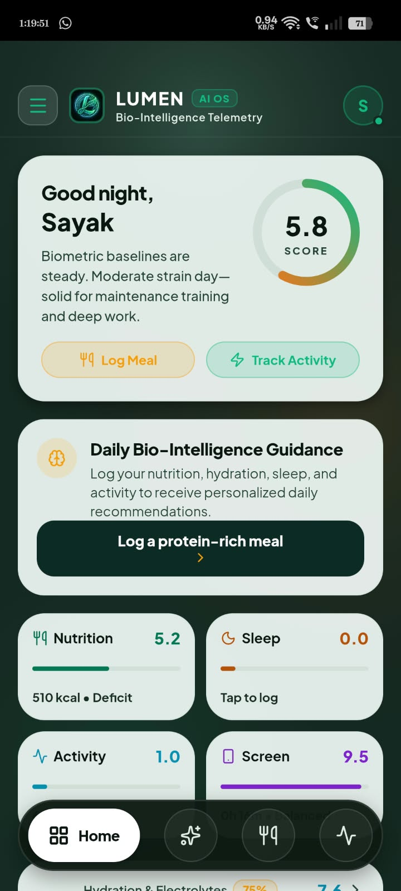
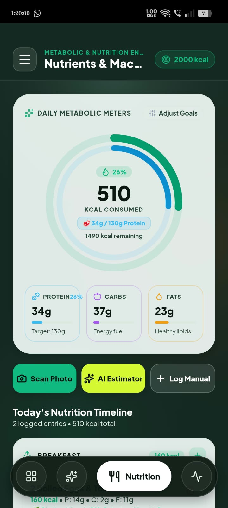
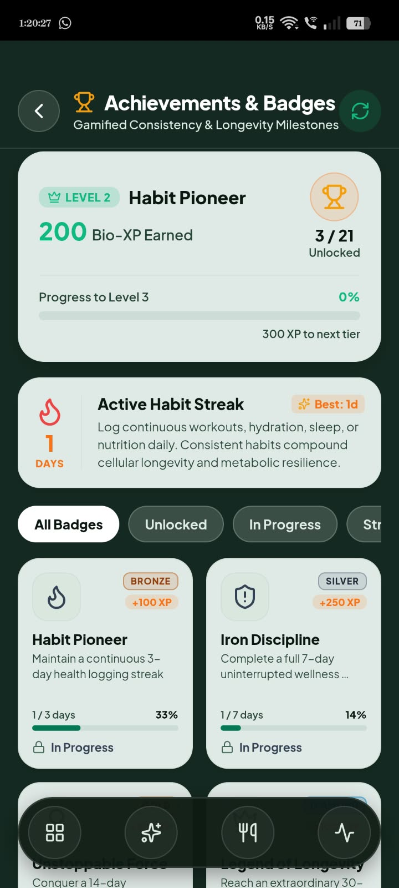

<div align="center">

# 🌿 Lumen AI OS

### Bio-Intelligence • Wellness Tracking • AI-Powered Longevity Insights

A wellness companion that brings nutrition, hydration, sleep, activity, and digital-wellbeing signals together to help users build healthier, more consistent routines.

[](#)
[](https://ai.google.dev/)
[](https://fastapi.tiangolo.com/)
[](LICENSE)

**Evidence-informed wellness. Useful insights. Consistent habits.**

</div>

---

## 📱 Screenshots

<p align="center">
  
  
  
</p>

## ✨ What is Lumen?

**Lumen AI OS** is a cross-platform wellness and bio-intelligence application focused on everyday health habits and longevity-oriented routines. It combines personal tracking, local-first data storage, native mobile capabilities, and AI-assisted interpretation in a single experience.

The dashboard presents a daily readiness-style score and wellness summaries. Users can log meals and hydration, track activity and sleep, configure reminders, and receive AI-generated guidance based on available information.

> Lumen is a wellness and educational tool—not a medical device. Its scores and AI outputs are not diagnoses or a substitute for professional medical care.

## 🌟 Key Features

### 🧬 Daily Bio-Readiness Dashboard
- A central 0–10 readiness-style score and daily overview.
- Summaries across nutrition, hydration, sleep, activity, and screen-time signals.
- Contextual guidance based on recorded metrics and available data.

### 🥗 Nutrition & Metabolic Tracking
- Meal logging and daily calorie tracking.
- Macronutrient tracking for protein, carbohydrates, and fats.
- Nutrition timeline and progress toward configurable targets.
- Meal-photo scanning / AI-assisted estimation where configured.

### 💤 Sleep, Activity & Digital Wellbeing
- Activity and step tracking using supported device sensors.
- Sleep and circadian-routine tracking.
- Digital-wellbeing and screen-time signals.
- Combined views intended to help users understand their daily habits.

### 🤖 Gemini-Powered AI Guidance
- AI-assisted synthesis across three wellness pillars:
  1. Biometrics and recovery
  2. Hydration and metabolism
  3. Sleep and circadian rhythm
- Conversational wellness coach with selectable guidance personas.
- AI-assisted meal estimation and interpretation when configured.
- Local caching and fallback behavior for resilience.

### ⏰ Reminders & Hydration
- Configurable hydration reminders and intake goals.
- Android-native alarm and notification integration, subject to device permissions and OS behavior.
- Reminder controls for habit consistency.

### 🏆 Achievements & Habit Streaks
- XP, levels, badges, and milestones.
- Progress tracking for consecutive wellness logging.
- A gamified approach to encourage consistency.

### 🔐 Local-First Data & Account Features
- SQLite-backed storage for supported mobile workflows.
- Authentication options documented in the project, including Google sign-in and email OTP.
- Offline queue support for configured telemetry synchronization.
- Google Sheets operational telemetry integration when enabled.

## 🧱 Architecture Overview

```text
Mobile / Web Client
  ├── Expo + React Native application
  ├── Capacitor Android runtime and native integrations
  ├── Dashboard, nutrition, activity, coach, reminders
  └── Local persistence (SQLite / platform storage)
          │
          ├── Google Gemini API
          │     └── AI wellness synthesis and meal interpretation
          │
          ├── FastAPI backend
          │     └── API, analysis, persistence, and supporting services
          │
          └── Google Apps Script Web App
                └── Optional Google Sheets telemetry
```

## 🛠️ Technology Stack

| Area | Technologies |
|---|---|
| Mobile application | Expo, React Native, TypeScript |
| Android integration | Capacitor, native Android APIs |
| Navigation | Expo Router |
| AI | Google Gemini API |
| Backend | Python, FastAPI, Uvicorn |
| Data | SQLite, SQLAlchemy, PostgreSQL / SQLite backend options |
| Client data fetching | TanStack React Query |
| Validation / API contracts | Zod, OpenAPI |
| Operational telemetry | Google Apps Script, Google Sheets |
| UI | React Native StyleSheet, custom design tokens, SVG visuals |

*The exact packages and versions may vary by branch. Refer to the repository manifests for the authoritative dependency list.*

## 🚀 Getting Started

### Prerequisites

- Node.js 20 or later
- pnpm
- Python 3.10+ for the backend
- Android Studio and Android SDK for native Android builds

### 1. Clone the repository

```bash
git clone https://github.com/sayaklearner-prog/lumen-wellness-app.git
cd lumen-wellness-app
pnpm install
```

### 2. Configure environment variables

Create `artifacts/mobile/.env` and add only the services you intend to use:

```env
EXPO_PUBLIC_GEMINI_API_KEY=your_gemini_api_key
EXPO_PUBLIC_SHEETS_WEBHOOK_URL=your_google_apps_script_web_app_url
EXPO_PUBLIC_API_URL=your_backend_base_url
```

**Security note:** Values prefixed with `EXPO_PUBLIC_` are bundled into the client application and should be treated as public. Do not place privileged or server-side secrets in these variables. For a production app, proxy sensitive API calls through a secured backend and apply appropriate key restrictions.

### 3. Start the mobile application

```bash
cd artifacts/mobile
npx expo start
```

Use the Expo CLI prompts to open the app on a supported device, emulator, or web target.

### 4. Build the Android application

The repository includes an Android native project. Follow the current project build instructions and Android Studio / Gradle configuration to generate an APK or app bundle.

> Native alarms, sensors, background behavior, and notifications depend on Android permissions, device settings, and OS-specific restrictions. Test these behaviors on real devices before release.

## 🔑 Integrations & Configuration

- **Google Gemini:** Configure a valid API key and select a supported model. Model availability and API behavior may change; consult the [Gemini API documentation](https://ai.google.dev/gemini-api/docs).
- **FastAPI backend:** Set the client API base URL to your deployed or local backend.
- **Google Sheets telemetry:** Optional. If enabled, configure your own Apps Script deployment and spreadsheet. Review the data being transmitted and access settings before deploying.
- **Native Android features:** Configure and test required permissions in the Android project.

Never commit `.env` files, credentials, signing keys, private telemetry URLs, or user data. Keep a sanitized `.env.example` in the repository instead.

## 🗺️ Roadmap

Potential areas for continued development:

- [ ] Improve onboarding and explain how wellness scores are calculated.
- [ ] Add transparent data-source and confidence indicators to AI-generated insights.
- [ ] Expand accessibility and responsive-layout testing.
- [ ] Add user-controlled data export and deletion workflows.
- [ ] Strengthen privacy documentation and production security review.
- [ ] Add automated tests for core tracking, scoring, and reminder workflows.

## 🤝 Contributing

Contributions, bug reports, and thoughtful feature suggestions are welcome.

1. Fork the repository.
2. Create a feature branch: `git checkout -b feature/your-feature`.
3. Make focused changes and test them.
4. Commit your work with a clear message.
5. Open a pull request describing the change and any relevant screenshots.

Please avoid submitting real personal health data, API keys, or credentials in issues and pull requests.

## 🛡️ Privacy & Wellness Disclaimer

Lumen is intended for wellness tracking and educational guidance. It does not diagnose, treat, cure, or prevent disease and is not a replacement for a qualified healthcare professional.

Health information is sensitive. Before using Lumen with real users, review the app’s storage, authentication, analytics, telemetry, API-key handling, data retention, and deletion behavior. Do not assume that a feature is private or compliant solely because it is described as local-first.

## 📄 License

This project is licensed under the **MIT License**. See [`LICENSE`](LICENSE) for details.

If you prefer to keep the code proprietary, do not publish this MIT license; use an appropriate proprietary license instead. The license should reflect your actual distribution intention.

## 👨‍💻 Author

**Sayak Mondal**  
AI, software development, and product engineering

- GitHub: [@sayaklearner-prog](https://github.com/sayaklearner-prog)
- Repository: [lumen-wellness-app](https://github.com/sayaklearner-prog/lumen-wellness-app)

---

<div align="center">

**Built with 💚 to make everyday wellness more understandable and actionable.**

⭐ If you find Lumen interesting, consider starring the repository!

</div>
